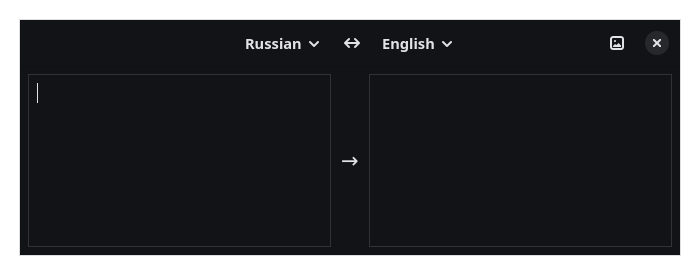

# Translator-gtk

A small GTK4 translator written in Rust, powered by Google Translate.



## Features

- Google Translate — free endpoint, no API key
- Automatic language detection
- Favorite languages (starred, pinned to the top of the picker)
- Language picker with search
- Swap languages (button or **Ctrl+R**)
- Image translation (OCR) via `tesseract` — from a file or the clipboard
- Config saved to `~/.config/translator-gtk/config.json`

## Usage

```sh
translator-gtk
```

A compact floating quick-translate window:

- translates instantly while you type
- **Enter** — copy the translation and close · **Shift+Enter** — newline
- **Ctrl+R** — swap languages · **Escape** — close
- **Ctrl+V** with an image in the clipboard — OCR and translate it
- **toggle**: running `translator-gtk` again while it is open closes it — bind
  the same key to `translator-gtk` for show/hide

## Build

```sh
cargo build --release
```

Requires GTK 4.12+. For image translation install tesseract with language data:

```sh
# Gentoo (LINGUAS picks the traineddata set)
LINGUAS="en ru" emerge app-text/tesseract app-text/tessdata_fast
# Arch
pacman -S tesseract tesseract-data-eng tesseract-data-rus
```

OCR uses the selected source language when its traineddata is installed,
otherwise it falls back to every installed language at once.

`wl-copy` (`wl-clipboard`) is recommended so the Enter-copy action
survives the window closing on Wayland.

### niri

The resizable window tiles by default. To keep it floating at its base
size add a window rule:

```kdl
window-rule {
    match app-id="com.whyoolw.Translator" title="Translator"
    open-floating true
}
```

## Adding a translation service

Implement the `Provider` trait in `src/providers.rs` and wire it up in
`app::build_app` (`src/app.rs`).
